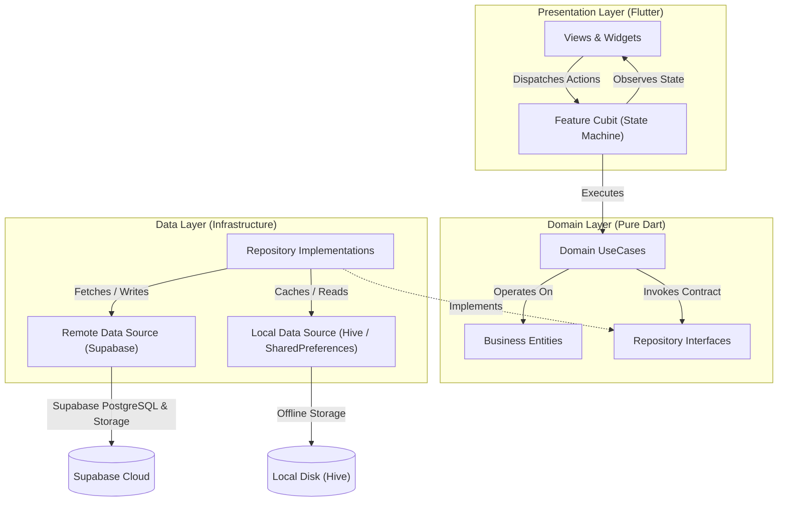
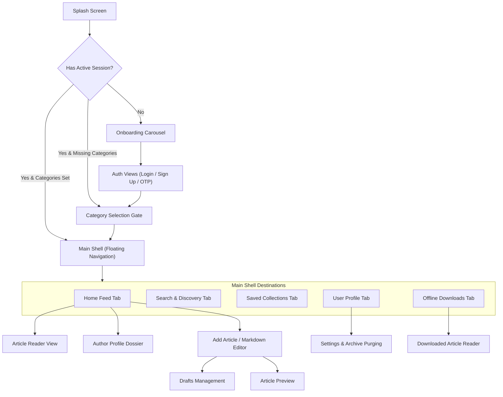

# Mind Feed

Mind Feed is an editorial-first mobile publishing and knowledge curation platform built with Flutter and Supabase. Designed for readers and thinkers seeking high-signal writing, the application provides a distraction-free, ad-free reading experience organized around 20 curated knowledge domains. It combines a paper-and-ink aesthetic with native text-only offline reading, community-driven content starring, author follow dossiers, and a democratic publishing workflow with pre-publish Markdown previews and draft management.

---

## Key Features

- **Editorial Home Feed & Discovery**: Curated feed tailored to user interests with lead story showcases, horizontal topic filtering across 20 curated categories, swipeable editorial card decks, and secondary story streams.
- **Distraction-Free Article Reader**: Immersive reading experience powered by formatted Markdown rendering, customizable typography (font scaling and line height), author attribution bar, and a VSYNC-driven smooth auto-scroller with velocity controls.
- **Text-Only Offline Collections**: Offline reader that downloads pure article Markdown into local Hive storage for bandwidth-conscious reading during flights and commutes, decoupled from image caching.
- **Bookmarks & Saved Stories**: Dedicated collections view for favorited articles with real-time sync across devices and instant retrieval.
- **Democratic Publishing & Drafts Management**: Integrated article creator with real-time word counting, form validation rules (12-word max title, 300-word min content, category selection, tag limits), cover image upload to Supabase Storage, local draft saving/editing, and a live pre-publish Markdown preview.
- **Author Dossiers & Social Endorsement**: Comprehensive author profile pages showcasing biographical details, total published stories, follower metrics, and average ratings. Readers can follow authors, star articles, rate writers on a 5-star scale, and share stories via the system share sheet.
- **Taxonomy Search & Tag Filtering**: Real-time keyword search with instant filtering chips spanning 20 fixed categories and curated tags.
- **Onboarding & Mandatory Topic Gate**: Multi-stage introduction carousel with chapter progression indicators, paired with a mandatory category selection gate ensuring personalized feeds before first access.
- **Account & Archive Management**: Complete profile management, avatar uploads, customizable reading preferences, dynamic archive cache size calculation with one-tap offline download purging, and secure session management.

---

## Technology Stack

| Layer / Concern | Technology | Purpose |
| :--- | :--- | :--- |
| **Framework & Language** | Flutter 3.9+ / Dart 3.9+ | Cross-platform mobile client application |
| **State Management** | `flutter_bloc` / Cubit | Unidirectional reactive state machines with Dart 3 sealed classes |
| **Dependency Injection** | `get_it` | Service locator for decoupled dependency wiring and lazy singletons |
| **Backend & Auth** | `supabase_flutter` | Authentication (Email/Password & OTP), PostgreSQL persistence, RLS security policies, and RPC triggers |
| **Cloud Storage** | Supabase Storage | Remote hosting for user avatars and article cover images |
| **Local Persistence** | `hive`, `hive_flutter`, `shared_preferences` | High-speed NoSQL box storage for offline article text, user sessions, and preferences |
| **Network & Connectivity** | `connectivity_plus`, `http` | Real-time network monitoring and external HTTP communications |
| **Typography & Markdown** | `flutter_markdown_plus`, `google_fonts` | Serif/editorial typography and formatted Markdown article rendering |
| **Design & Feedback** | `skeletonizer`, `flutter_svg` | Non-blocking skeleton loading states and vector iconography |

---

## Architecture & Engineering Patterns

The application follows **Feature-First Clean Architecture**, enforcing strict boundaries between Presentation, Domain, and Data layers.

### Architectural Principles

- **Presentation Layer**: Built exclusively with Flutter widgets and Cubits. UI components only observe state and dispatch user intents; no direct database calls or business logic exist in widgets.
- **Domain Layer**: 100% pure Dart containing business entities, repository contracts, and isolated use cases. The domain layer has zero dependencies on Flutter UI frameworks or third-party storage SDKs.
- **Data Layer**: Implements repository contracts by coordinating local data sources (`ArticlesLocalDataSource` backed by Hive) and remote data sources (`ArticlesRemoteDataSource` backed by Supabase). Converts raw network models to immutable domain entities.
- **Native Dart 3 `ApiResult<T>`**: Replaces external functional libraries with a native Dart 3 sealed class union (`Success<T>` and `FailureResult<T>`). All use cases return `Future<ApiResult<T>>`, forcing compile-time exhaustiveness checking via `.when()` or `switch` pattern matching in Cubits.
- **Centralized Dependency Injection**: Managed via `get_it` in `setup_service_locator.dart`, registering data sources, repositories, use cases, and cubits with lazy singletons and factory constructors.
- **Declarative Navigation**: Managed through a centralized `AppRoutes` class using `onGenerateRoute` with strongly-typed arguments and isolated page transitions.

### Clean Architecture Layers



### Navigation & Shell Structure



---

## Project Structure

The project follows a feature-first modular directory hierarchy:

```text
lib/
├── config/                  # App routing, themes, styling, and extensions
│   ├── routes/              # Centralized onGenerateRoute navigation (AppRoutes)
│   └── themes/              # Editorial typography, color palettes, and ThemeData
├── core/                    # Shared system kernel and cross-cutting modules
│   ├── articles/            # Core articles domain entities, repos, and datasources
│   ├── constants/           # Design tokens, category taxonomy, and route constants
│   ├── database/            # Local cache helpers and Hive storage adapters
│   ├── design/              # Reusable editorial components (cards, stacks, avatars)
│   ├── errors/              # Typed Failures and exception hierarchies
│   ├── networking/          # Native Dart 3 ApiResult<T> and NetworkInfo
│   ├── services/            # CurrentUserSession, AppInfo, SupabaseStorage
│   ├── utls/                # Service locator configuration (setup_service_locator.dart)
│   └── widgets/             # Generic atomic UI primitives (buttons, text fields)
└── features/                # Domain-isolated feature modules
    ├── add_article/         # Article authoring, Markdown editor, drafts, and preview
    ├── article/             # Distraction-free reader, typography, and auto-scroller
    ├── auth/                # Login, signup, OTP confirmation, and password recovery
    ├── author/              # Author dossiers, statistics, and follow workflows
    ├── collections/         # Bookmarked stories and offline downloaded articles
    ├── home/                # Editorial home feed, card decks, and topic streams
    ├── main/                # Root navigation shell with floating navigation bar
    ├── onboarding/          # Introduction carousel with chapter indicators
    ├── profile/             # User profile, authored articles, and category onboarding
    ├── search/              # Real-time search and 20-category taxonomy filtering
    ├── settings/            # Theme switching, font preferences, and archive clearing
    └── splash/              # Startup gatekeeper and initial routing resolution
```

---

## Quality Assurance & Verification

The codebase maintains automated test coverage across domain logic, data repositories, state management cubits, and presentation widget trees.

- **Test Suite Organization**:
  - `test/core/`: Validation tests for design tokens, category constants, author follow logic, and services.
  - `test/features/`: Feature-scoped unit tests covering UseCases, Repository implementations, Cubit state transitions, and interactive Widget test flows.
  - `test/`: Integration and regression verification covering end-to-end authentication, offline cache clearing on logout, and theme persistence.
- **Verification Commands**:
  - Run the complete automated test suite:
    ```bash
    flutter test
    ```
    *Current Status*: **461 passing tests** (0 failures).
  - Execute static analysis and lint inspection:
    ```bash
    flutter analyze
    ```
    *Current Status*: **0 analyzer issues** (clean analysis).

---

## Continuous Integration & Release Pipelines

Automated GitHub Actions workflows ensure continuous delivery and artifact generation on commits to `main` and release tags (`v*`):

- **Android APK Build Pipeline (`.github/workflows/build-apk.yml`)**:
  - Executes on Ubuntu with Java 17 and Flutter.
  - Secures build credentials via repository secrets.
  - Builds both a universal APK (`MindFeed-v<version>-universal.apk`) and ABI-specific packages (`arm64-v8a`, `armeabi-v7a`, `x86_64`).
  - Stashes build artifacts and publishes release assets directly to GitHub Releases.
- **iOS Unsigned IPA Pipeline (`.github/workflows/ios-unsigned-ipa.yml`)**:
  - Executes on macOS with Xcode and Flutter.
  - Compiles unsigned release binaries for manual signing and internal testing.
  - Archives build outputs and automatically attaches IPA packages to matching release tags.

---

## Knowledge Graph & Codebase Navigation

This repository is indexed with a structural knowledge graph generated by **Graphify**, mapping cross-file dependencies, community clusters, and core abstractions.

- **Graph Metadata**:
  - Stored in `graphify-out/` (over 5,000 nodes and 8,400 edges across 220+ modular communities).
  - Visual summary available in `graphify-out/GRAPH_REPORT.md`.
- **Querying the Graph**:
  - Search concepts and features:
    ```bash
    graphify query "<question or symbol>"
    ```
  - Trace relationships between components:
    ```bash
    graphify path "<ComponentA>" "<ComponentB>"
    ```
  - Inspect focused abstractions:
    ```bash
    graphify explain "<SymbolName>"
    ```
  - Re-index after modifying code:
    ```bash
    graphify update .
    ```

---

## Architectural Documentation & References

For in-depth product requirements, business rationales, and historical refactoring audits, refer to:

- [CONTEXT.md](file:///media/windows/workspace/My_Apps/Mind_Feed/mind_feed/CONTEXT.md): Detailed architectural overview, recent system changes, and credential conventions.
- [BRD.md](file:///media/windows/workspace/My_Apps/Mind_Feed/mind_feed/BRD.md): Business Requirements Document outlining commercial objectives, KPIs, and governance policies.
- [SPEC.md](file:///media/windows/workspace/My_Apps/Mind_Feed/mind_feed/SPEC.md): Core functional specifications, persona user stories, and acceptance criteria.
- [docs/reports/](file:///media/windows/workspace/My_Apps/Mind_Feed/mind_feed/docs/reports/): Comprehensive engineering reports, covering Clean Architecture refactoring, Supabase backend security, and raster performance optimizations.
