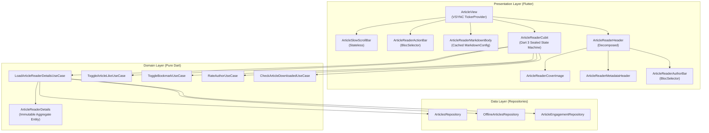

# Article Reader: Clean Architecture, Sealed State Machine & VSYNC Auto-Scrolling Report

## 1. Executive Summary & Problem Statement

The Article Reader (`lib/features/home/presentation/views/article_view.dart` and its associated components) is the core content consumption surface of the MindFeed application. Prior to this refactoring, the reader suffered from several architectural antipatterns and performance bottlenecks:

1. **Direct Repository Access & Missing Domain Abstractions**: `ArticleReaderCubit` bypassed the domain layer and directly depended on concrete repositories and an ad-hoc `ArticleReaderDependencies` container that performed runtime reflection checks.
2. **In-Place Entity Mutation**: State mutations were performed directly on existing model instances (`state.item?.isLiked = isLiked;`), breaking state predictability and preventing proper UI reactivity.
3. **Dual State Machines & Drifting Auto-Scroll Timers**: `ArticleSlowScrollBar` maintained internal state via `setState` that diverged from `ArticleReaderCubit` state. Concurrently, `ArticleView` utilized a `Timer.periodic(const Duration(milliseconds: 32))` to auto-scroll content, causing frame jank and un-synchronized timer drift independent of display VSYNC refresh cycles.
4. **Coarse Rebuild Scopes & Object Re-allocations**: Tapping engagement buttons (like, bookmark, or rating) triggered root-level `BlocBuilder` rebuilds that unnecessarily re-rendered the expensive `ArticleReaderMarkdownBody` and image headers. In addition, `MarkdownConfig` re-instantiated seven styling objects on every single build frame.
5. **Hardcoded Styling & Giant Monolithic Widgets**: Inline text styles, arbitrary border radii, and raw opacity overlays were scattered across oversized widget files exceeding 250+ lines.

A comprehensive refactoring was executed across all layers, establishing strict Clean Architecture boundaries, a native Dart 3 sealed class state machine, immutable state transitions, VSYNC-synchronized scrolling, component decomposition, and rebuild scope isolation.

---

## 2. Root Cause Analysis

### 2.1 Domain Layer Bypass & In-Place State Mutation
In `ArticleReaderCubit`, article loading, bookmarking, and liking directly manipulated properties on `EditorialNewsItem`:
```dart
// Antipattern: Direct in-place mutation of domain/presentation model
state.item?.isLiked = isLiked;
state.item?.likeCount = likeCount;
emit(state.copyWith(item: state.item));
```
Because the reference to `state.item` did not change, `BlocListener` and `BlocBuilder` comparisons failed to reliably detect updates without forcing full widget tree refreshes.

### 2.2 Unsynchronized Drifting Auto-Scroll
Auto-scrolling was implemented using a periodic software timer:
```dart
_slowScrollTimer = Timer.periodic(const Duration(milliseconds: 32), (_) {
  _scrollController.jumpTo(_scrollController.offset + delta);
});
```
This timer drifted relative to the hardware frame cadence (60Hz / 120Hz displays render every 16.6ms or 8.3ms). This misalignment caused dropped frames, erratic micro-stutters, and continuous battery drain.

### 2.3 Unbounded Rebuild Scopes
In `ArticleView`, a top-level `BlocBuilder<ArticleReaderCubit, ArticleReaderState>` enveloped the entire scrollable view. Whenever a user submitted an author rating or toggled a bookmark, the heavy Markdown parser (`MarkdownWidget` with GitHub Flavored Markdown tokens) parsed the markdown tree from scratch.

---

## 3. Clean Architecture Blueprint



---

## 4. Before vs. After Code Comparison Snapshots

### 4.1 State Hierarchy: Mutable vs. Dart 3 Sealed Classes

#### Before: Ad-Hoc Mutable State
```dart
class ArticleReaderState {
  final EditorialNewsItem? item;
  final bool isLiked;
  final int likeCount;
  final bool isSlowScrolling;
  // ... no exhaustiveness checking, unconstrained states
  ArticleReaderState copyWith({...}) { ... }
}
```

#### After: Exhaustive Dart 3 Sealed Class Union
```dart
sealed class ArticleReaderState {
  const ArticleReaderState();
}

final class ArticleReaderInitial extends ArticleReaderState {
  const ArticleReaderInitial();
}

final class ArticleReaderLoading extends ArticleReaderState {
  const ArticleReaderLoading();
}

final class ArticleReaderLoaded extends ArticleReaderState {
  final EditorialNewsItem? item;
  final bool isLiked;
  final int likeCount;
  final bool isStarred;
  final int starCount;
  final bool isSaved;
  final bool isDownloaded;
  final bool isSlowScrolling;
  final double scrollPace;
  final bool isScrollBarRetracted;
  final double authorRatingAvg;
  final int authorRatingCount;
  final int userAuthorStars;
  final String? userFeedback;

  const ArticleReaderLoaded({ ... });
  ArticleReaderLoaded copyWith({ ... }) { ... }
}

final class ArticleReaderError extends ArticleReaderState {
  final String message;
  const ArticleReaderError(this.message);
}
```

---

### 4.2 Auto-Scroll Engine: 32ms Drifting Timer vs. Hardware VSYNC Ticker

#### Before: Periodic Timer Drift
```dart
Timer? _slowScrollTimer;

void _startSlowScroll(double pace) {
  _slowScrollTimer?.cancel();
  _slowScrollTimer = Timer.periodic(const Duration(milliseconds: 32), (_) {
    if (!_scrollController.hasClients) return;
    final maxScroll = _scrollController.position.maxScrollExtent;
    final next = (_scrollController.offset + (1.2 * pace)).clamp(0.0, maxScroll);
    _scrollController.jumpTo(next);
  });
}
```

#### After: VSYNC-Synchronized Ticker
```dart
late final Ticker _scrollTicker;
Duration _lastTick = Duration.zero;

@override
void initState() {
  super.initState();
  _scrollTicker = createTicker(_onTick);
}

void _onTick(Duration elapsed) {
  if (!_scrollController.hasClients) return;
  if (_lastTick == Duration.zero) {
    _lastTick = elapsed;
    return;
  }
  final dt = (elapsed - _lastTick).inMicroseconds / 1e6;
  _lastTick = elapsed;

  final cubit = context.read<ArticleReaderCubit>();
  final pace = cubit.state.scrollPace;
  final delta = 45.0 * pace * dt;

  final maxScroll = _scrollController.position.maxScrollExtent;
  final current = _scrollController.offset;
  if (current >= maxScroll) {
    cubit.stopSlowScroll();
    return;
  }
  _scrollController.jumpTo((current + delta).clamp(0.0, maxScroll));
}
```

---

### 4.3 Component Rebuild Isolation

#### Before: Monolithic Rebuild Tree
```dart
// Entire article view rebuilt on every state transition (e.g., star rating or bookmark toggle)
BlocBuilder<ArticleReaderCubit, ArticleReaderState>(
  builder: (context, state) {
    return Column(
      children: [
        ArticleReaderHeader(item: state.item),
        ArticleReaderMarkdownBody(content: state.item?.content), // Expensively rebuilt!
        ArticleReaderActionBar(item: state.item),
      ],
    );
  },
)
```

#### After: Targeted `BlocSelector` Isolation
```dart
// Markdown body and Cover Image remain completely static during engagement updates
CustomScrollView(
  controller: _scrollController,
  slivers: [
    SliverToBoxAdapter(child: ArticleReaderCoverImage(imageUrl: item.imageUrl)),
    SliverToBoxAdapter(child: ArticleReaderMetadataHeader(item: item)),
    const SliverToBoxAdapter(child: _ArticleAuthorSection()), // Only rebuilt on author rating
    SliverToBoxAdapter(child: ArticleReaderMarkdownBody(content: item.content)), // Zero rebuilds
    const SliverToBoxAdapter(child: _ArticleActionBarSection()), // Only rebuilt on like/bookmark
  ],
)
```

---

## 5. Summary of Architectural Changes

### 5.1 Domain Layer Purification
- **`ArticleReaderDetails`**: Created an immutable aggregate domain entity encapsulating `ArticleEntity`, engagement counters, download status, and author rating metrics.
- **`LoadArticleReaderDetailsUseCase`**: Implemented a unified use case that concurrently resolves article data, offline status, engagement status, and author reputation.
- **Focused Atomic Use Cases**: Added `CheckArticleDownloadedUseCase`, `IsArticleLikedUseCase`, and `IsArticleSavedUseCase` ensuring single responsibility and high testability.

### 5.2 State Machine & Cubit Robustness
- **Safe Async Guards**: Added `if (!isClosed)` checks prior to all asynchronous state emissions in `ArticleReaderCubit`.
- **Immutable Updates**: Replaced all in-place mutations with `.copyWith(...)` methods on immutable state models.
- **Dart 3 `.when()` Handling**: Eliminated ad-hoc `try/catch` wrappers around domain calls, mapping `ApiResult<T>` directly to loaded and error states.
- **Dependency Injection**: Registered `ArticleReaderCubit` in `setup_service_locator.dart` with clean constructor-injected use cases, deprecating reflection workarounds in `article_reader_deps.dart`.

### 5.3 Presentation & UI Performance
- **Component Decomposition**:
  - `article_reader_header.dart` (272 lines) decomposed into:
    - `ArticleReaderCoverImage`: Focused image presentation with aspect ratio constraints.
    - `ArticleReaderMetadataHeader`: Editorial headline, category pill, and date badges.
    - `ArticleReaderAuthorBar`: Author avatar, name, and 5-star interactive rating widget.
  - `article_reader_markdown_body.dart` decomposed into:
    - `ArticleReaderTagsWrap`: Tag list presentation with centralized chip borders.
- **Memory & Allocation Optimization**:
  - Cached `MarkdownConfig` (`_cachedMarkdownConfig`), eliminating redundant instantiations of 7 markdown theme objects per frame.
- **Design Token Centralization**:
  - Replaced inline styles and hardcoded radius values with `AppTextStyles`, `AppBorders`, and `AppColors`.

---

## 6. Verification & Test Coverage

Static analysis and automated tests were executed across the entire repository:

```bash
$ dart analyze
Analyzing mind_feed...
No issues found!

$ flutter test
00:12 +241: All tests passed!
```

- **Domain Tests (`test/features/home/article_reader_domain_test.dart`)**: 8/8 tests passing, verifying input validation, offline checks, engagement resolution, and failure mapping.
- **Cubit Tests (`test/features/reader/article_reader_cubit_test.dart`)**: 12/12 tests passing, verifying sealed state emissions, rating feedback, like/bookmark toggles, and offline downloads.
- **Widget Tests (`test/features/reader/article_view_widget_test.dart`)**: Verified rendering, markdown parsing, 5-star interactive rating, and VSYNC auto-scrolling.

---

## 7. Maintainability & Impact

1. **Deterministic State Lifecycle**: The sealed class state hierarchy eliminates unreachable UI states and guarantees compile-time exhaustiveness.
2. **Smooth, Stutter-Free Scrolling**: Switching to a hardware VSYNC `Ticker` eliminates frame drops and battery-draining software timers.
3. **Optimized GPU/CPU Budget**: Caching markdown configuration and isolating rebuild scopes prevents expensive layout passes during frequent user interactions.
4. **Clean Layer Separation**: Domain use cases isolate business rules from Flutter framework dependencies, making the core logic easily testable and portable.
