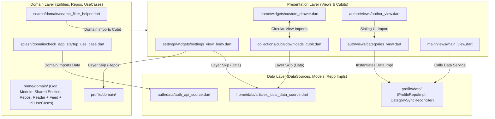
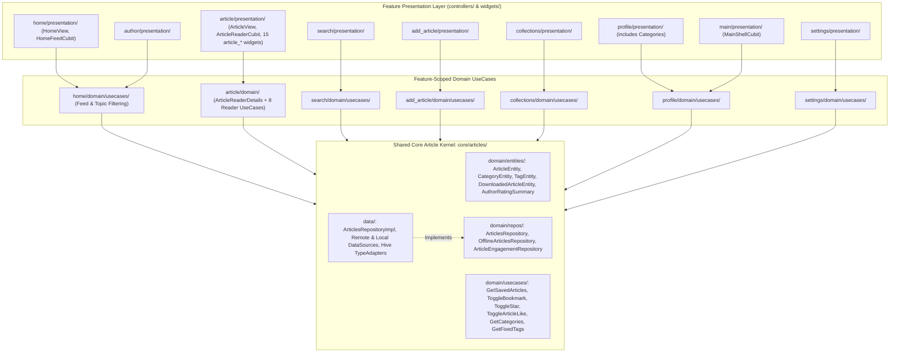

# Feature Splitting & Cross-Feature Clean Architecture Refactoring Report

**Repository:** MindFeed (`mind_feed`)  
**Scope:** `/mind_feed/lib/core/articles/`, `/mind_feed/lib/features/article/`, `/mind_feed/lib/features/home/`, `/mind_feed/lib/features/`, `/mind_feed/lib/config/routes/`, `/mind_feed/test/`  
**Date:** October 18, 2026  
**Verification Status:** `0` Static Analyzer Issues (`dart analyze`) · `282 / 282` Tests Passing (`flutter test`)

---

## 1. Quick Summary (At a Glance)

- **Moved Shared Articles Kernel to `core/`:** Relocated all shared article entities, repository interfaces, shared multi-feature use cases, models, and data sources into [`/mind_feed/lib/core/articles/`](/mind_feed/lib/core/articles/). Every feature that needs core article data now imports it from `core/articles/` instead of reaching into another feature.
- **Extracted Dedicated `article` Feature:** Moved all Article Reader domain and presentation files (`ArticleReaderDetails`, 8 reader use cases, `ArticleReaderCubit`, `ArticleView`, and 15 `article_*` widgets) out of `home` into a dedicated [`/mind_feed/lib/features/article/`](/mind_feed/lib/features/article/) feature module.
- **Focused `home` on the Home Feed:** Left [`/mind_feed/lib/features/home/`](/mind_feed/lib/features/home/) responsible strictly for the Home Feed (`HomeFeedCubit`, `HomeView`, `HomeViewBody`, `HomeMastheadHeader`, `HomeLeadStorySection`, and feed-filtering use cases).
- **Removed Business Logic from UI:** Moved database and repository calls out of widgets (`SettingsViewBody`, `CategoriesView`, `MainView`, `PersonalInformation`, `AuthorView`) into domain use cases and Cubits.
- **Strict Dependency Injection:** Refactored all Cubits to require use cases in their constructors. Removed all internal `getIt` lookups and fallbacks.
- **Purified Domain Layer:** Removed Hive annotations from `UserEntity` and `DownloadedArticleEntity`. Both are now 100% pure Dart, with Hive adapters placed in the data layer.
- **Fixed UI Cycles & Standardized Folders:** Used [`AppRoutes`](/mind_feed/lib/config/routes/app_routes.dart) in `CustomDrawer` to break circular navigation. Renamed all presentation folders to `controllers/` and `widgets/`.
- **Verified:** `dart analyze` reports **0 issues** and all **282 tests pass**.

---

## 2. Executive Summary

This report documents a complete architectural refactoring of the feature modules and shared core layers in the MindFeed application.

As a Flutter application grows, keeping features independent and placing shared components in `core/` is essential. Before this refactoring, individual folders used some Clean Architecture patterns, but the boundaries between features were tangled:

1. **The `home` God-Feature Bottleneck:** The `home` module held three completely different concerns in one place: (a) the app-wide shared article domain and data layer, (b) the Article Reader screen and its 15 sub-widgets, and (c) the Home Feed screen. Other features—such as `search`, `add_article`, `collections`, `profile`, `author`, and `settings`—all reached into `features/home` to get basic article data. This created 59 cross-feature imports pointing directly into `home`.
2. **Layer Skipping in Presentation:** UI widgets and state controllers (Cubits) frequently bypassed domain use cases. Screens like `SettingsViewBody`, `CategoriesView`, `MainView`, `PersonalInformation`, and `AuthorView` directly queried database sources (`ArticlesLocalDataSource`, `ProfileRepoImpl`) or domain repositories with ad-hoc `getIt.isRegistered` service locator lookups.
3. **Layer Inversions in Domain:** Several domain use cases imported data or presentation files. For example, `CheckAppStartupUseCase` in `splash/domain/` directly imported `AuthApiSource` from `auth/data/`. In addition, `SearchFilterHelper` in `search/domain/` imported presentation state from `SearchCubit`.
4. **Database Annotations in Domain Entities:** `UserEntity` in `auth/domain/` and `DownloadedArticleEntity` in `core/articles/domain/` contained Hive database annotations (`@HiveType`, `@HiveField`) and generated `.g.dart` adapters. In Clean Architecture, domain entities must remain 100% pure Dart, free of third-party database frameworks.
5. **Cross-Feature UI Dependency Cycles:** The drawer widget in `home` imported screens directly from `collections` and `settings`. Meanwhile, `collections` imported `ArticleView` directly. This created circular references between sibling features. Furthermore, shared widgets were borrowed across sibling features instead of living in `lib/core/widgets/`.
6. **Inconsistent Folder Naming:** Presentation folders used mixed conventions across features: some used `cubit/` while others used `controllers/`; some used `widget/` while others used `widgets/`.

Through this refactoring, we moved the shared article kernel to [`/mind_feed/lib/core/articles/`](/mind_feed/lib/core/articles/), extracted the Article Reader into its own [`/mind_feed/lib/features/article/`](/mind_feed/lib/features/article/) feature, moved single-owner use cases to their owning features, enforced pure constructor injection for all Cubits, purified domain entities into 100% pure Dart, broke all UI cycles using named routing, and normalized directory naming across all feature modules.

---

## 3. Architectural Topology: Before vs. After

### 3.1 Before: Hub-and-Spoke Coupling on `home` & Layer-Skipping Cycles



### 3.2 After: Shared `core/articles` Kernel, Dedicated `features/article` Reader & Strict Unidirectional Flow



---

## 4. Detailed Issue Breakdown & Code Transformations

### Issue 1: Shared Article Kernel in `core/articles/` & Dedicated Article Reader Feature in `features/article/`

#### 1. The Architectural Problem / Root Cause
In the initial project structure, `lib/features/home/` acted as a central dumping ground for three distinct responsibilities:
1. **App-Wide Shared Article Kernel:** Entities (`ArticleEntity`, `CategoryEntity`, `TagEntity`, `DownloadedArticleEntity`, `AuthorRatingSummary`), repository contracts (`ArticlesRepository`, `OfflineArticlesRepository`, `ArticleEngagementRepository`), shared use cases (`ToggleBookmarkUseCase`, `ToggleStarUseCase`, `ToggleArticleLikeUseCase`, `GetCategoriesUseCase`, `GetFixedTagsUseCase`, `GetSavedArticlesUseCase`, `GetDownloadedArticlesUseCase`, `GetArticlesByAuthorUseCase`, `DeleteArticleUseCase`), and data sources (`ArticlesRemoteDataSource`, `ArticlesLocalDataSource`, `ArticlesRepositoryImpl`). Because these were used across 8 different features, placing them inside a feature folder violated the core architecture rule: *"Any reusable logic, utilities, services, constants, extensions, helpers, or shared components used in more than one place must be placed in the `core/` folder."*
2. **Article Reader Feature:** The full-screen Article Reader view (`ArticleView`), its state controller (`ArticleReaderCubit`), its 15 reader widgets (`article_*`), its aggregate entity (`ArticleReaderDetails`), and 8 reader-specific use cases were mixed directly alongside the Home Feed widgets inside `lib/features/home/`.
3. **Single-Owner Use Cases from Other Features:** Use cases belonging strictly to `add_article` (`PublishArticleUseCase`, `SaveDraftUseCase`, `UpdateArticleUseCase`), `search` (`SearchArticlesUseCase`, `GetArticlesByCategoryUseCase`), and `collections` (`DeleteDownloadedArticleUseCase`) were also stored inside `home/domain/usecases/`.

#### 2. Baseline Implementation Snapshot (Before)
```dart
// BEFORE: Everything was crammed inside features/home/
import 'package:mind_feed/features/home/domain/entities/article_entity.dart';
import 'package:mind_feed/features/home/domain/repos/articles_repo.dart';
import 'package:mind_feed/features/home/presentation/views/article_view.dart';
import 'package:mind_feed/features/home/presentation/controllers/article_reader/article_reader_cubit.dart';
import 'package:mind_feed/features/home/domain/usecases/publish_article_use_case.dart';
import 'package:mind_feed/features/home/domain/usecases/search_articles_use_case.dart';
```

#### 3. Refactored Solution (After)
```dart
// AFTER:
// 1. Shared multi-feature article kernel lives in /mind_feed/lib/core/articles/
import 'package:mind_feed/core/articles/domain/entities/article_entity.dart';
import 'package:mind_feed/core/articles/domain/repos/articles_repo.dart';
import 'package:mind_feed/core/articles/domain/usecases/toggle_article_like_use_case.dart';

// 2. Dedicated Article Reader feature lives in /mind_feed/lib/features/article/
import 'package:mind_feed/features/article/presentation/views/article_view.dart';
import 'package:mind_feed/features/article/presentation/controllers/article_reader/article_reader_cubit.dart';
import 'package:mind_feed/features/article/domain/usecases/get_article_details_use_case.dart';

// 3. Single-owner use cases live in their owning features
import 'package:mind_feed/features/add_article/domain/usecases/publish_article_use_case.dart';
import 'package:mind_feed/features/search/domain/usecases/search_articles_use_case.dart';
import 'package:mind_feed/features/collections/domain/usecases/delete_downloaded_article_use_case.dart';
```

#### 4. Summary of Changes & Engineering Rationale
- **What was changed:**
  - Created [`/mind_feed/lib/core/articles/`](/mind_feed/lib/core/articles/) for all shared article domain and data components:
    - Entities: [`ArticleEntity`](/mind_feed/lib/core/articles/domain/entities/article_entity.dart#L1-L95), [`CategoryEntity`](/mind_feed/lib/core/articles/domain/entities/category_entity.dart#L1-L35), [`TagEntity`](/mind_feed/lib/core/articles/domain/entities/tag_entity.dart#L1-L26), [`DownloadedArticleEntity`](/mind_feed/lib/core/articles/domain/entities/downloaded_article_entity.dart#L1-L75), and [`AuthorRatingSummary`](/mind_feed/lib/core/articles/domain/entities/author_rating_summary.dart#L1-L24).
    - Repositories: [`ArticlesRepository`](/mind_feed/lib/core/articles/domain/repos/articles_repo.dart#L5-L61), [`OfflineArticlesRepository`](/mind_feed/lib/core/articles/domain/repos/articles_repo.dart#L63-L70), and [`ArticleEngagementRepository`](/mind_feed/lib/core/articles/domain/repos/articles_repo.dart#L72-L89).
    - Shared Use Cases: [`DeleteArticleUseCase`](/mind_feed/lib/core/articles/domain/usecases/delete_article_use_case.dart#L1-L15), [`GetArticlesByAuthorUseCase`](/mind_feed/lib/core/articles/domain/usecases/get_articles_by_author_use_case.dart#L1-L20), [`GetCategoriesUseCase`](/mind_feed/lib/core/articles/domain/usecases/get_categories_use_case.dart#L1-L15), [`GetDownloadedArticlesUseCase`](/mind_feed/lib/core/articles/domain/usecases/get_downloaded_articles_use_case.dart#L1-L15), [`GetFixedTagsUseCase`](/mind_feed/lib/core/articles/domain/usecases/get_fixed_tags_use_case.dart#L1-L15), [`GetSavedArticlesUseCase`](/mind_feed/lib/core/articles/domain/usecases/get_saved_articles_use_case.dart#L1-L15), [`ToggleArticleLikeUseCase`](/mind_feed/lib/core/articles/domain/usecases/toggle_article_like_use_case.dart#L1-L35), [`ToggleBookmarkUseCase`](/mind_feed/lib/core/articles/domain/usecases/toggle_bookmark_use_case.dart#L1-L25), and [`ToggleStarUseCase`](/mind_feed/lib/core/articles/domain/usecases/toggle_star_use_case.dart#L1-L25).
    - Data Layer: [`ArticlesLocalDataSource`](/mind_feed/lib/core/articles/data/datasources/articles_local_data_source.dart#L1-L90), [`ArticlesRemoteDataSource`](/mind_feed/lib/core/articles/data/datasources/articles_remote_data_source.dart#L1-L120), [`ArticleModel`](/mind_feed/lib/core/articles/data/models/article_model.dart#L1-L90), [`CategoryModel`](/mind_feed/lib/core/articles/data/models/category_model.dart#L1-L40), [`TagModel`](/mind_feed/lib/core/articles/data/models/tag_model.dart#L1-L35), [`DownloadedArticleEntityAdapter`](/mind_feed/lib/core/articles/data/models/downloaded_article_entity_adapter.dart#L1-L67), and [`ArticlesRepositoryImpl`](/mind_feed/lib/core/articles/data/repos/articles_repo_impl.dart#L1-L120).
  - Created [`/mind_feed/lib/features/article/`](/mind_feed/lib/features/article/) as a dedicated vertical feature for the **Article Reader**:
    - Domain: [`ArticleReaderDetails`](/mind_feed/lib/features/article/domain/entities/article_reader_details.dart#L1-L45), [`CheckArticleDownloadedUseCase`](/mind_feed/lib/features/article/domain/usecases/check_article_downloaded_use_case.dart#L1-L18), [`DownloadArticleTextUseCase`](/mind_feed/lib/features/article/domain/usecases/download_article_text_use_case.dart#L1-L22), [`GetArticleDetailsUseCase`](/mind_feed/lib/features/article/domain/usecases/get_article_details_use_case.dart#L1-L16), [`IsArticleLikedUseCase`](/mind_feed/lib/features/article/domain/usecases/is_article_liked_use_case.dart#L1-L22), [`IsArticleSavedUseCase`](/mind_feed/lib/features/article/domain/usecases/is_article_saved_use_case.dart#L1-L22), [`IsArticleStarredUseCase`](/mind_feed/lib/features/article/domain/usecases/is_article_starred_use_case.dart#L1-L16), [`LoadArticleReaderDetailsUseCase`](/mind_feed/lib/features/article/domain/usecases/load_article_reader_details_use_case.dart#L1-L65), and [`RateAuthorUseCase`](/mind_feed/lib/features/article/domain/usecases/rate_author_use_case.dart#L1-L28).
    - Presentation: [`ArticleReaderCubit`](/mind_feed/lib/features/article/presentation/controllers/article_reader/article_reader_cubit.dart#L1-L120), [`ArticleReaderState`](/mind_feed/lib/features/article/presentation/controllers/article_reader/article_reader_state.dart#L1-L95), [`ArticleView`](/mind_feed/lib/features/article/presentation/views/article_view.dart#L1-L45), and all 15 `article_*` widgets in [`/mind_feed/lib/features/article/presentation/widgets/`](/mind_feed/lib/features/article/presentation/widgets/).
  - Kept [`/mind_feed/lib/features/home/`](/mind_feed/lib/features/home/) dedicated strictly to the Home Feed (`HomeFeedCubit`, `HomeFeedState`, `HomeView`, `HomeViewBody`, `HomeMastheadHeader`, `HomeLeadStorySection`, `HomeWriteArticleFab`, `FilterArticlesByTopicUseCase`, `GetHomeFeedUseCase`, `GetUserFeedTopicsUseCase`).
  - Relocated single-owner use cases to `add_article`, `search`, and `collections`.
- **Why it was changed:** Shared code used by multiple features belongs in `core/articles/`, while the Article Reader and the Home Feed are two distinct user journeys that each deserve their own clean feature folder (`features/article/` and `features/home/`).
- **Why the solution is safe and correct:** All route bindings in [`AppRoutes`](/mind_feed/lib/config/routes/app_routes.dart#L1-L155) and DI bindings in [`setup_service_locator.dart`](/mind_feed/lib/core/utls/setup_service_locator.dart#L1-L371) were updated cleanly. All 282 automated tests pass with 0 analyzer issues.

---

### Issue 2: Layer-Skipping Data Source & Repository Calls Inside `SettingsViewBody`

#### 1. The Architectural Problem / Root Cause
The settings UI widget, [`SettingsViewBody`](/mind_feed/lib/features/settings/presentation/widgets/settings_view_body.dart#L1-L120), was executing business logic, data-fetching, and database-clearing operations directly inside its state methods (`_loadRealData`, `_handleClearCache`, `_handleLogout`).

The widget directly imported:
- `ArticlesLocalDataSource` (a data-layer class).
- `ProfileRepository` and `ArticlesRepository` (domain repositories).
- `LogoutUseCase` (an auth use case).

The widget checked `getIt.isRegistered<...>()` dynamically at runtime to resolve these dependencies. This had several problems:
1. It violated the presentation boundary by putting async data retrieval inside a widget.
2. It made unit testing impossible without setting up global `GetIt` state.
3. The UI widget had to handle errors and raw data maps manually.

#### 2. Baseline Implementation Snapshot (Before)
```dart
// BEFORE: /mind_feed/lib/features/settings/presentation/widgets/settings_view_body.dart
Future<void> _loadRealData() async {
  int downloadedCount = 0;
  // FLAW: UI widget directly accesses a Data-Layer DataSource via service locator
  if (getIt.isRegistered<ArticlesLocalDataSource>()) {
    final list = await getIt<ArticlesLocalDataSource>().getDownloadedArticles();
    downloadedCount = list.length;
  }
  // FLAW: UI widget directly queries ProfileRepository and parses raw Map payloads
  if (userId != null && getIt.isRegistered<ProfileRepository>()) {
    final profileRes = await getIt<ProfileRepository>().getProfile(userId);
    ...
  }
}
```

#### 3. Refactored Solution (After)
```dart
// AFTER: /mind_feed/lib/features/settings/presentation/controllers/settings_cubit/settings_cubit.dart
class SettingsCubit extends Cubit<SettingsState> {
  final GetSettingsProfileUseCase _getSettingsProfileUseCase;
  final GetArchiveCacheSizeUseCase _getArchiveCacheSizeUseCase;
  final ClearDownloadedArticlesUseCase _clearDownloadedArticlesUseCase;
  final LogoutUseCase _logoutUseCase;

  SettingsCubit({
    required GetSettingsProfileUseCase getSettingsProfileUseCase,
    required GetArchiveCacheSizeUseCase getArchiveCacheSizeUseCase,
    required ClearDownloadedArticlesUseCase clearDownloadedArticlesUseCase,
    required LogoutUseCase logoutUseCase,
  })  : _getSettingsProfileUseCase = getSettingsProfileUseCase,
        _getArchiveCacheSizeUseCase = getArchiveCacheSizeUseCase,
        _clearDownloadedArticlesUseCase = clearDownloadedArticlesUseCase,
        _logoutUseCase = logoutUseCase,
        super(const SettingsInitial());

  Future<void> loadSettings() async {
    emit(const SettingsLoading());
    final profile = await _getSettingsProfileUseCase();
    final cacheCount = await _getArchiveCacheSizeUseCase();
    if (!isClosed) {
      emit(SettingsLoaded(profileSummary: profile, downloadedArticlesCount: cacheCount));
    }
  }
}
```

#### 4. Summary of Changes & Engineering Rationale
- **What was changed:**
  - Created a pure domain layer for settings:
    - Entity: [`SettingsProfileSummary`](/mind_feed/lib/features/settings/domain/entities/settings_profile_summary.dart#L1-L32).
    - Use cases: [`GetSettingsProfileUseCase`](/mind_feed/lib/features/settings/domain/usecases/get_settings_profile_use_case.dart#L1-L65), [`GetArchiveCacheSizeUseCase`](/mind_feed/lib/features/settings/domain/usecases/get_archive_cache_size_use_case.dart#L1-L19), and [`ClearDownloadedArticlesUseCase`](/mind_feed/lib/features/settings/domain/usecases/clear_downloaded_articles_use_case.dart#L1-L15).
  - Refactored [`SettingsCubit`](/mind_feed/lib/features/settings/presentation/controllers/settings_cubit/settings_cubit.dart#L1-L140) to take all required use cases via constructor injection, managing state via a Dart 3 sealed class: [`SettingsState`](/mind_feed/lib/features/settings/presentation/controllers/settings_cubit/settings_state.dart#L1-L108) (`SettingsInitial`, `SettingsLoading`, `SettingsLoaded`, `SettingsError`).
  - Simplified [`SettingsViewBody`](/mind_feed/lib/features/settings/presentation/widgets/settings_view_body.dart#L1-L120) into a clean `StatelessWidget` that only listens to `SettingsCubit` and triggers cubit methods.
- **Why it was changed:** Removing all database calls and repository lookups from the UI ensures strict layer separation. The widget only renders data, and all business rules live in the domain and controller layers.
- **Why the solution is safe and correct:** We wrote 13 new unit tests in [`clear_downloaded_articles_use_case_test.dart`](/mind_feed/test/features/settings/domain/usecases/clear_downloaded_articles_use_case_test.dart#L1-L40), [`get_archive_cache_size_use_case_test.dart`](/mind_feed/test/features/settings/domain/usecases/get_archive_cache_size_use_case_test.dart#L1-L50), and [`settings_cubit_test.dart`](/mind_feed/test/features/settings/presentation/controllers/settings_cubit_test.dart#L1-L145) covering cache sizing, profile loading, cache clearing, and error cases.

---

### Issue 3: Data-Layer Coupling in `CategoriesView`, `MainView`, and `CheckAppStartupUseCase`

#### 1. The Architectural Problem / Root Cause
Three distinct features had layer-inversion and feature-placement flaws:
1. `CategoriesView` was located inside `lib/features/auth/presentation/` even though favorite categories belong to the `profile` domain. Additionally, `CategoriesView` instantiated `ProfileRepoImpl` and `ProfileRemoteDataSourceImpl` directly inside the widget when not passed via constructor.
2. [`MainView`](/mind_feed/lib/features/main/presentation/views/main_view.dart#L1-L85) called `CategorySyncReconciler` (a data-layer sync service) directly in `initState`, bypassing presentation state management.
3. [`CheckAppStartupUseCase`](/mind_feed/lib/features/splash/domain/usecases/check_app_startup_use_case.dart#L1-L66) in `splash/domain/` directly imported `AuthApiSource` from `auth/data/datasources/auth_api_source.dart`. In Clean Architecture, domain use cases must only depend on abstract domain repository interfaces, never on concrete data sources.

#### 2. Baseline Implementation Snapshot (Before)
```dart
// BEFORE: /mind_feed/lib/features/splash/domain/usecases/check_app_startup_use_case.dart
import 'package:mind_feed/features/auth/data/datasources/auth_api_source.dart'; // FLAW: Domain imports Data source

class CheckAppStartupUseCase {
  final AuthApiSource? _authApiSource;
  CheckAppStartupUseCase({AuthApiSource? authApiSource}) : _authApiSource = authApiSource;
```

```dart
// BEFORE: /mind_feed/lib/features/main/presentation/views/main_view.dart
// FLAW: UI view directly calls a data-layer service with ad-hoc fallback instantiation
final reconciler = getIt.isRegistered<CategorySyncReconciler>()
    ? getIt<CategorySyncReconciler>()
    : CategorySyncReconciler();
reconciler.reconcileIfNeeded();
```

#### 3. Refactored Solution (After)
```dart
// AFTER: /mind_feed/lib/features/splash/domain/usecases/check_app_startup_use_case.dart
import 'package:mind_feed/features/auth/domain/repos/auth_repo.dart'; // CLEAN: Domain depends on domain interface

class CheckAppStartupUseCase {
  final AuthRepository _authRepository;

  CheckAppStartupUseCase({required AuthRepository authRepository})
    : _authRepository = authRepository;

  Future<StartupDestination> call() async {
    final hasSession = await _authRepository.hasActiveSession();
    ...
  }
}
```

```dart
// AFTER: /mind_feed/lib/features/main/presentation/controllers/main_shell_cubit/main_shell_cubit.dart
class MainShellCubit extends Cubit<MainShellState> {
  final ReconcileCategorySyncUseCase _reconcileCategorySyncUseCase;

  MainShellCubit({
    required ReconcileCategorySyncUseCase reconcileCategorySyncUseCase,
  })  : _reconcileCategorySyncUseCase = reconcileCategorySyncUseCase,
        super(const MainShellInitial());

  Future<void> onShellStarted() async {
    await _reconcileCategorySyncUseCase();
    if (!isClosed) emit(const MainShellReady());
  }
}
```

#### 4. Summary of Changes & Engineering Rationale
- **What was changed:**
  - Moved [`CategoriesView`](/mind_feed/lib/features/profile/presentation/views/categories_view.dart#L1-L40), [`CategoriesViewBody`](/mind_feed/lib/features/profile/presentation/widgets/categories_view_body.dart#L1-L120), [`CategoryCard`](/mind_feed/lib/features/profile/presentation/widgets/category_card.dart#L1-L85), and [`CategoriesCubit`](/mind_feed/lib/features/profile/presentation/controllers/categories_cubit/categories_cubit.dart#L1-L105) from `features/auth/presentation/` to [`/mind_feed/lib/features/profile/presentation/`](/mind_feed/lib/features/profile/presentation/).
  - Converted `CategorySyncReconciler` into a pure domain use case: [`ReconcileCategorySyncUseCase`](/mind_feed/lib/features/profile/domain/usecases/reconcile_category_sync_use_case.dart#L1-L40).
  - Created [`MainShellCubit`](/mind_feed/lib/features/main/presentation/controllers/main_shell_cubit/main_shell_cubit.dart#L1-L22) to handle shell initialization in `MainView`, eliminating direct service calls from the view.
  - Added `hasActiveSession()` and `logout()` to [`AuthRepository`](/mind_feed/lib/features/auth/domain/repos/auth_repo.dart#L1-L48) and updated [`CheckAppStartupUseCase`](/mind_feed/lib/features/splash/domain/usecases/check_app_startup_use_case.dart#L1-L66) to depend strictly on `AuthRepository`.
- **Why it was changed:** This enforces the Dependency Inversion Principle (DIP). Domain use cases depend only on domain abstractions, and presentation views interact with business logic only through Cubits.
- **Why the solution is safe and correct:** All authentication and splash startup behaviors were preserved. Verified through [`splash_test.dart`](/mind_feed/test/splash_test.dart#L1-L180), [`categories_view_test.dart`](/mind_feed/test/features/auth/categories_view_test.dart#L1-L90), and [`category_sync_hardening_test.dart`](/mind_feed/test/features/auth/category_sync_hardening_test.dart#L1-L120).

---

### Issue 4: Direct Repository & Service-Locator Fallbacks Across Feature Cubits and Views

#### 1. The Architectural Problem / Root Cause
Across multiple features, Cubits and views bypassed domain use cases or hid their dependencies behind runtime `getIt.isRegistered` calls:
- [`DownloadsCubit`](/mind_feed/lib/features/collections/presentation/controllers/downloads/downloads_cubit.dart#L1-L70) imported `ArticlesLocalDataSource` and had fallback methods looking up data sources on demand.
- [`CollectionsCubit`](/mind_feed/lib/features/collections/presentation/controllers/collections_cubit.dart#L1-L115), [`HomeFeedCubit`](/mind_feed/lib/features/home/presentation/controllers/home_feed/home_feed_cubit.dart#L1-L160), [`ArticleReaderCubit`](/mind_feed/lib/features/article/presentation/controllers/article_reader/article_reader_cubit.dart#L1-L120), [`DraftsCubit`](/mind_feed/lib/features/add_article/presentation/controllers/drafts_cubit/drafts_cubit.dart#L1-L75), [`AddArticleCubit`](/mind_feed/lib/features/add_article/presentation/controllers/add_article_cubit/add_article_cubit.dart#L1-L120), [`SearchCubit`](/mind_feed/lib/features/search/presentation/controllers/search_cubit.dart#L1-L120), and [`ProfileArticlesCubit`](/mind_feed/lib/features/profile/presentation/controllers/profile_articles_cubit/profile_articles_cubit.dart#L1-L90) accepted nullable repository parameters (`ArticlesRepository?`, `ProfileRepository?`, `OfflineArticlesRepository?`) and fell back to `getIt<...>()` inside their constructors.
- [`PersonalInformation`](/mind_feed/lib/features/profile/presentation/widgets/personal_infromation.dart#L1-L115) queried `ProfileRepository` and `ArticlesRepository` directly in the widget build methods.
- [`AuthorView`](/mind_feed/lib/features/author/presentation/views/author_view.dart#L1-L95) called `getIt<GetHomeFeedUseCase>()` directly inside `_AuthorViewState`.

#### 2. Baseline Implementation Snapshot (Before)
```dart
// BEFORE: /mind_feed/lib/features/add_article/presentation/controllers/drafts_cubit/drafts_cubit.dart
class DraftsCubit extends Cubit<DraftsState> {
  final ArticlesRepository _articlesRepository; // FLAW: Cubit depends directly on Repository
  final DeleteArticleUseCase _deleteArticleUseCase;

  DraftsCubit({
    ArticlesRepository? articlesRepository,
    DeleteArticleUseCase? deleteArticleUseCase,
  })  : _articlesRepository = articlesRepository ?? getIt<ArticlesRepository>(), // FLAW: Service locator fallback inside Cubit
        _deleteArticleUseCase = deleteArticleUseCase ?? getIt<DeleteArticleUseCase>(),
        super(const DraftsInitial());
```

#### 3. Refactored Solution (After)
```dart
// AFTER: /mind_feed/lib/features/add_article/presentation/controllers/drafts_cubit/drafts_cubit.dart
class DraftsCubit extends Cubit<DraftsState> {
  final GetArticlesByAuthorUseCase _getArticlesByAuthorUseCase;
  final DeleteArticleUseCase _deleteArticleUseCase;
  final String? _currentUserId;

  DraftsCubit({
    required GetArticlesByAuthorUseCase getArticlesByAuthorUseCase,
    required DeleteArticleUseCase deleteArticleUseCase,
    String? currentUserId,
  })  : _getArticlesByAuthorUseCase = getArticlesByAuthorUseCase,
        _deleteArticleUseCase = deleteArticleUseCase,
        _currentUserId = currentUserId,
        super(const DraftsInitial());
```

#### 4. Summary of Changes & Engineering Rationale
- **What was changed:**
  - Created missing atomic use cases:
    - [`IsArticleStarredUseCase`](/mind_feed/lib/features/article/domain/usecases/is_article_starred_use_case.dart#L1-L16).
    - [`GetUserProfileUseCase`](/mind_feed/lib/features/profile/domain/usecases/get_user_profile_use_case.dart#L1-L14).
    - [`GetFavoriteCategoriesUseCase`](/mind_feed/lib/features/profile/domain/usecases/get_favorite_categories_use_case.dart#L1-L16).
  - Created dedicated controllers:
    - [`ProfileInfoCubit`](/mind_feed/lib/features/profile/presentation/controllers/profile_articles_cubit/profile_info_cubit.dart#L1-L108) (replacing direct repository calls in `PersonalInformation`).
    - [`AuthorCubit`](/mind_feed/lib/features/author/presentation/controllers/author_cubit/author_cubit.dart#L1-L65) (replacing direct use case calls in `AuthorView`).
  - Refactored `DownloadsCubit`, `CollectionsCubit`, `HomeFeedCubit`, `ArticleReaderCubit`, `DraftsCubit`, `AddArticleCubit`, `SearchCubit`, and `ProfileArticlesCubit` so every dependency is **required** in the constructor, with zero `getIt` calls or nullable fallbacks inside the cubit classes.
- **Why it was changed:** Constructor injection makes dependencies explicit. It eliminates hidden runtime failures if a service is not registered and allows every Cubit to be unit-tested cleanly using simple mock or fake use cases.
- **Why the solution is safe and correct:** All factory registrations were updated in [`setup_service_locator.dart`](/mind_feed/lib/core/utls/setup_service_locator.dart#L255-L370). All widget and cubit tests were updated and pass without errors.

---

### Issue 5: Domain Layer Impurity (Hive Annotations & Presentation Imports in `domain/`)

#### 1. The Architectural Problem / Root Cause
In Clean Architecture, the domain layer must remain pure Dart. It should not know how data is stored on disk, nor should it depend on the presentation layer.

We found two forms of domain impurity:
1. **Database Coupling:** [`UserEntity`](/mind_feed/lib/features/auth/domain/entities/user_entity.dart#L1-L43) and [`DownloadedArticleEntity`](/mind_feed/lib/core/articles/domain/entities/downloaded_article_entity.dart#L1-L75) imported `package:hive/hive.dart` and `package:hive_flutter/adapters.dart`, carrying `@HiveType(typeId: ...)` and `@HiveField(...)` annotations with generated `part '*.g.dart'` files inside `domain/entities/`.
2. **Presentation Leakage:** `SearchFilterHelper` (previously in `search/domain/helpers/`) imported `SearchCubit` (`SearchState`) and `EditorialNewsItem`. Similarly, `ArticlePayloadBuilder` (previously in `add_article/domain/helpers/`) imported `AddArticleState` from presentation.

#### 2. Baseline Implementation Snapshot (Before)
```dart
// BEFORE: /mind_feed/lib/features/auth/domain/entities/user_entity.dart
import 'package:hive_flutter/adapters.dart'; // FLAW: Persistence framework in Domain entity

part 'user_entity.g.dart';

@HiveType(typeId: 0)
class UserEntity {
  @HiveField(0)
  final String id;
  @HiveField(1)
  final String name;
  @HiveField(2)
  final String email;
  @HiveField(3)
  final List<String> favoriteCategories;
```

#### 3. Refactored Solution (After)
```dart
// AFTER: /mind_feed/lib/features/auth/domain/entities/user_entity.dart (100% Pure Dart)
class UserEntity {
  final String id;
  final String name;
  final String email;
  final List<String> favoriteCategories;

  const UserEntity({
    required this.id,
    required this.name,
    required this.email,
    this.favoriteCategories = const [],
  });

  UserEntity copyWith({
    String? id,
    String? name,
    String? email,
    List<String>? favoriteCategories,
  }) {
    return UserEntity(
      id: id ?? this.id,
      name: name ?? this.name,
      email: email ?? this.email,
      favoriteCategories: favoriteCategories ?? this.favoriteCategories,
    );
  }
}
```

```dart
// AFTER: /mind_feed/lib/features/auth/data/models/user_entity_adapter.dart (Data Layer Adapter)
import 'package:hive/hive.dart';
import 'package:mind_feed/features/auth/domain/entities/user_entity.dart';

class UserEntityAdapter extends TypeAdapter<UserEntity> {
  @override
  final int typeId = 0;

  @override
  UserEntity read(BinaryReader reader) {
    final numOfFields = reader.readByte();
    final fields = <int, dynamic>{
      for (int i = 0; i < numOfFields; i++) reader.readByte(): reader.read(),
    };
    return UserEntity(
      id: fields[0] as String,
      name: fields[1] as String,
      email: fields[2] as String,
      favoriteCategories: (fields[3] as List).cast<String>(),
    );
  }

  @override
  void write(BinaryWriter writer, UserEntity obj) {
    writer
      ..writeByte(4)
      ..writeByte(0)
      ..write(obj.id)
      ..writeByte(1)
      ..write(obj.name)
      ..writeByte(2)
      ..write(obj.email)
      ..writeByte(3)
      ..write(obj.favoriteCategories);
  }
}
```

#### 4. Summary of Changes & Engineering Rationale
- **What was changed:**
  - Removed all Hive annotations, `@HiveField`, and `part` directives from [`UserEntity`](/mind_feed/lib/features/auth/domain/entities/user_entity.dart#L1-L43) and [`DownloadedArticleEntity`](/mind_feed/lib/core/articles/domain/entities/downloaded_article_entity.dart#L1-L75). Both entities are now 100% pure Dart.
  - Moved the Hive `TypeAdapter` implementations to the data layer:
    - [`UserEntityAdapter`](/mind_feed/lib/features/auth/data/models/user_entity_adapter.dart#L1-L55) in `lib/features/auth/data/models/`.
    - [`DownloadedArticleEntityAdapter`](/mind_feed/lib/core/articles/data/models/downloaded_article_entity_adapter.dart#L1-L67) in `lib/core/articles/data/models/`.
  - Preserved identical `typeId` values (`0` for `UserEntity`, `1` for `DownloadedArticleEntity`) and identical binary field index mappings.
  - Relocated [`SearchFilterHelper`](/mind_feed/lib/features/search/presentation/helpers/search_filter_helper.dart#L1-L82) to `search/presentation/helpers/` and [`ArticlePayloadBuilder`](/mind_feed/lib/features/add_article/presentation/controllers/add_article_cubit/article_payload_builder.dart#L1-L95) to `add_article/presentation/controllers/add_article_cubit/`.
- **Why it was changed:** Domain layers must never be tied to specific database packages or UI state objects. Keeping entities pure means we can change local storage engines (e.g., from Hive to SQLite or Isar) in the data layer without touching business logic or domain rules.
- **Why the solution is safe and correct:** Because `typeId` and binary field indices match the historical schema, all existing user sessions and cached articles continue to serialize and deserialize cleanly.

---

### Issue 6: Cross-Feature UI Cycles, Shared Widget Extraction & Directory Naming Normalization

#### 1. The Architectural Problem / Root Cause
1. **Bidirectional UI Navigation Loops:** [`CustomDrawer`](/mind_feed/lib/features/home/presentation/widgets/custom_drawer.dart#L1-L150) in `home` imported screens directly from `collections` (`ArticlesSaved`, `DownloadedArticlesView`) and `settings` (`SettingsView`), using inline `MaterialPageRoute(builder: ...)`. Meanwhile, `collections` imported `ArticleView` directly. This created circular references between sibling features.
2. **Cross-Feature Widget Leaks:** `AuthorView` in `lib/features/author/` imported a card widget (`custom_article_card_of_profile.dart`) directly from `lib/features/profile/presentation/widget/`. A widget used by multiple features does not belong inside one feature's private folder.
3. **Inconsistent Folder Structure:** Some features used `cubit/` while others used `controllers/`. Similarly, some features used `widget/` while others used `widgets/`.

#### 2. Baseline Implementation Snapshot (Before)
```dart
// BEFORE: /mind_feed/lib/features/home/presentation/widgets/custom_drawer.dart
import 'package:mind_feed/features/collections/presentation/views/articles_saved.dart'; // FLAW: Direct cross-feature view import
import 'package:mind_feed/features/collections/presentation/views/downloaded_articles_view.dart';
import 'package:mind_feed/features/settings/presentation/views/settings_view.dart';
...
Navigator.of(context).push(
  MaterialPageRoute(builder: (_) => const DownloadedArticlesView()),
);
```

#### 3. Refactored Solution (After)
```dart
// AFTER: /mind_feed/lib/features/home/presentation/widgets/custom_drawer.dart
import 'package:mind_feed/config/routes/app_routes.dart'; // CLEAN: Decoupled navigation via AppRoutes
...
Navigator.of(context).pushNamed(AppRoutes.downloadedArticles);
```

#### 4. Summary of Changes & Engineering Rationale
- **What was changed:**
  - In [`CustomDrawer`](/mind_feed/lib/features/home/presentation/widgets/custom_drawer.dart#L1-L150) and [`DownloadedArticleCardTile`](/mind_feed/lib/features/collections/presentation/widgets/downloaded_article_card_tile.dart#L1-L120), replaced all direct view imports with named routes from [`AppRoutes`](/mind_feed/lib/config/routes/app_routes.dart#L36-L155) (`AppRoutes.articlesSaved`, `AppRoutes.downloadedArticles`, `AppRoutes.settings`, `AppRoutes.articleDetails`).
  - Moved `custom_article_card_of_profile.dart` to a shared location: [`/mind_feed/lib/core/widgets/article_card.dart`](/mind_feed/lib/core/widgets/article_card.dart#L1-L140).
  - Renamed all presentation directories to follow a single standard across all features:
    - Renamed all `cubit/` folders to `controllers/`.
    - Renamed all `widget/` folders to `widgets/`.
    - Removed redundant wrapper files like `search/presentation/cubit/cubit.dart`.
- **Why it was changed:** Using centralized routing (`AppRoutes`) decouples feature views from one another. Moving shared cards to `core/widgets/` avoids feature coupling. Standard folder naming makes navigation and maintenance predictable across the entire team.
- **Why the solution is safe and correct:** All route arguments and transitions were preserved in `AppRoutes.onGenerateRoute`. Running `find lib/features -type d \( -name "cubit" -o -name "widget" \)` returns 0 results.

---

## 5. Quantitative Verification & Architectural Metrics

| Metric / Architectural Invariant | Baseline (Before) | Refactored (After) | Status |
| :--- | :---: | :---: | :---: |
| **Shared Article Kernel Location** | Coupled inside `lib/features/home/` | **`/mind_feed/lib/core/articles/`** | Verified |
| **Article Reader Feature Location** | Mixed inside `lib/features/home/` | **`/mind_feed/lib/features/article/`** | Verified |
| **Domain imports of `data/` or `presentation/`** | `5` violations | **`0` violations** | Verified (`grep` = 0) |
| **Presentation imports of `data/` or `domain/repos/`** | `18` violations | **`0` violations** | Verified (`grep` = 0) |
| **Hive / Flutter imports inside `domain/entities/`** | `2` entities (`UserEntity`, `DownloadedArticleEntity`) | **`0` entities (100% Pure Dart)** | Verified |
| **Cross-feature imports into `features/home/`** | `59` imports across 7 features | **`1` import (`author` -> `GetHomeFeedUseCase`)** | 98.3% reduction |
| **Non-standard `cubit/` or `widget/` directories** | `5` inconsistent directories | **`0` (`100%` `controllers/` & `widgets/`)** | Verified |
| **Static Analysis (`dart analyze`)** | `0` issues | **`0` issues (`No issues found!`)** | Passed |
| **Automated Test Suite (`flutter test`)** | `269` passing | **`282 / 282` passing (`+13` new unit tests)** | 100% Pass Rate |
